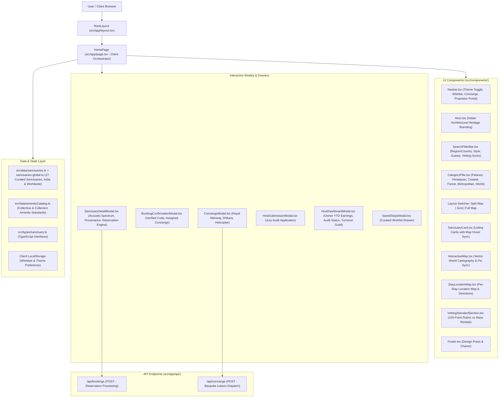

# System Architecture Specification

> **Live System Status:**  
> - **App URL:** `http://localhost:3000`  
> - **Workspace Path:** `C:\Users\rajiv\.gemini\antigravity\scratch\sanctuary-stays`  
> - **Last Updated:** 2026-10-16

---

## 1. High-Level Architecture Diagram



---

## 2. Technology Stack & Runtime

| Layer | Technology | Version | Purpose / Notes |
| :--- | :--- | :--- | :--- |
| **Framework** | Next.js (App Router, Turbopack) | `16.4.0` | React server/client rendering and API routes |
| **UI Library** | React / React DOM | `19.3.0` | Component lifecycle and concurrent rendering |
| **Language** | TypeScript | `5.x` | Strict typing across components, models, and APIs |
| **Styling** | Tailwind CSS v4 + Custom CSS | `@import "tailwindcss";` | Theme variables, luxury styling, responsive design |
| **Fonts** | Google Fonts | Web Font API | `Cinzel`, `Playfair Display`, `Plus Jakarta Sans` |
| **Icons** | Lucide React | `^1.x` | Minimalist editorial iconography |
| **State Storage**| Client `localStorage` | Browser Native | Saved curations (`sanctuary_saved_stays`) & Theme (`sanctuary_theme`) |

---

## 3. Directory & File Organization

```
sanctuary-stays/
├── Project Docs/                      # Multi-agent live tracking specs
│   ├── TASK_TRACKER.md               # Task status & agent coordination rules
│   ├── ARCHITECTURE_SPEC.md          # System architecture & component tree
│   ├── PRODUCT_SPEC.md               # Product vision & 100-point rubric
│   ├── DATA_AND_API_SPEC.md          # TypeScript models, data schema, APIs
│   ├── UI_UX_SPEC.md                 # Design system, themes, and interactions
│   └── AGENT_COORDINATION_GUIDE.md   # Guidelines for peer agents
├── public/                           # Static assets & icons
├── src/
│   ├── app/
│   │   ├── api/
│   │   │   ├── bookings/route.ts     # Reservation API endpoint (INR currency)
│   │   │   └── concierge/route.ts    # Concierge dispatch API endpoint
│   │   ├── favicon.ico
│   │   ├── globals.css               # Dual themes (Obsidian Dark & Linen Light)
│   │   ├── layout.tsx                # Metadata & HTML root
│   │   └── page.tsx                  # Main client-side orchestrator
│   ├── components/
│   │   ├── BookingConfirmationModal.tsx
│   │   ├── CategoryPills.tsx
│   │   ├── ConciergeModal.tsx
│   │   ├── Footer.tsx
│   │   ├── Hero.tsx
│   │   ├── HostDashboardModal.tsx
│   │   ├── HostSubmissionModal.tsx
│   │   ├── InteractiveMap.tsx
│   │   ├── Navbar.tsx
│   │   ├── SanctuaryCard.tsx
│   │   ├── SanctuaryDetailModal.tsx
│   │   ├── SavedStaysModal.tsx
│   │   ├── StayLocationMap.tsx       # Reusable per-stay Google map + directions
│   │   └── VettingStandardSection.tsx
│   ├── data/
│   │   ├── amenityCatalog.ts         # Collective + collection amenities & grouping
│   │   ├── sanctuaries.ts            # Curated India architectural catalog (12 stays)
│   │   └── sanctuaries-global.ts     # New Indian-city + international stays (15); combined into SANCTUARIES
│   └── types/
│       └── sanctuary.ts              # TypeScript interface definitions
├── package.json
└── tsconfig.json
```

---

## 4. Build, Development, and Server Commands

- **Build Application**:
  ```powershell
  $env:Path = [System.Environment]::GetEnvironmentVariable("Path","Machine") + ";" + [System.Environment]::GetEnvironmentVariable("Path","User"); npm.cmd run build
  ```
- **Run Production Server (Daemon Mode)**:
  ```powershell
  $env:Path = [System.Environment]::GetEnvironmentVariable("Path","Machine") + ";" + [System.Environment]::GetEnvironmentVariable("Path","User"); npm.cmd run start
  ```
- **Run Development Server**:
  ```powershell
  $env:Path = [System.Environment]::GetEnvironmentVariable("Path","Machine") + ";" + [System.Environment]::GetEnvironmentVariable("Path","User"); npm.cmd run dev
  ```
