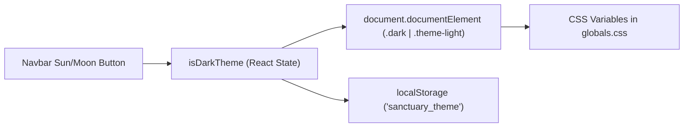

# UI/UX & Design System Specification

> **Aesthetic Philosophy:** Architectural Digest meets Kinfolk & Aman Resorts  
> **Typography Stack:** `Cinzel` (Editorial Serif), `Playfair Display` (Classic Serif), `Plus Jakarta Sans` (Contemporary Sans)  
> **Last Updated:** 2026-10-17

---

## 1. Dual Theme Engine

The application features a fully reactive dual theme system toggled via the Sun/Moon icon in `Navbar.tsx` and persisted in `localStorage.getItem('sanctuary_theme')`.

### Color Palette Tokens

| Variable | Midnight Obsidian (Dark) | Warm Editorial Linen (Light) | Purpose |
| :--- | :--- | :--- | :--- |
| `--background` | `#0b0c0e` (Obsidian Charcoal) | `#fbf9f5` (Warm Creamy Linen) | Page background |
| `--foreground` | `#ede8df` (Ivory Sand) | `#1c1917` (Deep Warm Charcoal) | Primary text |
| `--card-bg` | `#121418` (Dark Slate Glass) | `#ffffff` (Pure White Slate) | Surface panels & cards |
| `--card-border` | `rgba(255, 255, 255, 0.08)` | `rgba(0, 0, 0, 0.09)` | Delicate dividers & borders |
| `--accent-gold` | `#d4af37` (Champagne Gold) | `#b38947` (Antique Brass/Bronze) | Accents, badges, active states |
| `--secondary-text`| `#a8a194` (Muted Warm Stone) | `#78716c` (Muted Bronze Taupe) | Secondary metadata & captions |

---

## 2. Layout View Modes (`src/app/page.tsx`)

Users can switch between three responsive layout modes via the toolbar in the main explorer section:

1. **Split-Screen Map View (`viewMode === 'split'`) [Default]**:
   - **Left Column (6 cols):** Scrollable 2-column card deck of vetted properties.
   - **Right Column (6 cols):** Viewport-sticky interactive Google world map with floating neighborhood vibe rating bar.
   - **Hover Sync:** Hovering a card pulses and highlights its map pin; hovering a pin highlights its card and shows the vibe bar.
2. **Editorial Grid View (`viewMode === 'grid'`)**:
   - 3-column classic magazine card deck displaying full imagery and vetting scores.
3. **Full-Width Map View (`viewMode === 'map'`)**:
   - 700px high full-width Google map with interactive pins and zoom/recenter controls.

---

## 3. Interactive Map — Google Maps (`src/components/InteractiveMap.tsx`)

- **Cartography:** Live **Google Maps JavaScript API** rendered through `@vis.gl/react-google-maps` (`APIProvider` → `Map` → `AdvancedMarker`). Loaded client-side only.
- **Configuration (`.env.local`):** `NEXT_PUBLIC_GOOGLE_MAPS_API_KEY` (required — Maps JavaScript API key, restricted by HTTP referrer) and optional `NEXT_PUBLIC_GOOGLE_MAPS_MAP_ID` (vector styling + Advanced Markers; falls back to Google's shared `DEMO_MAP_ID`). A template lives in `.env.example`. If no key is present a branded *Connect Google Maps* placeholder renders instead, so the build and site never break.
- **Theme-Aware Style:** `colorScheme` switches between `ColorScheme.DARK` (*Midnight Obsidian*) and `ColorScheme.LIGHT` (*Warm Editorial Linen*) live with the theme toggle.
- **Price Pin Badges:** Custom `AdvancedMarkerElement` markers with a `.snc-marker-pill` HTML child formatted in INR (`₹1,25,000`), center-anchored (`anchorLeft`/`anchorTop: -50%`). The active pin (hovered or selected) turns champagne-gold and scales up (`.snc-marker-pill.is-active`).
- **Data-Driven Plotting:** Every sanctuary is plotted from its real `location.coordinates` (lat/lng); the map auto-`fitBounds` to the filtered result set and pan/zooms to a selected stay (zooming to level **14** so the exact property area is legible).
- **Controls:** In-map zoom in/out, recenter-to-world, and native fullscreen toggle (`requestFullscreen`), plus a live stay count. Google's default UI is disabled.
- **Map Types:** A segmented **Default / Satellite / Terrain** switcher (`MapTypeSwitcher.tsx`) updates `mapTypeId` live without reloading the map. Max zoom raised to **20** for street-level inspection.
- **Hover Sync:** Hovering a card highlights its pin (and vice-versa) driven by `hoveredSanctuaryId`; clicking a pin opens the detail modal.
- **Floating Vibe Bar:** Displays ambient acoustics (*21 dB Quiet*), dark-sky Bortle class, and private perimeter score (*99 / 100*), offset above the Google attribution.
- **Portable Per-Stay Map (`StayLocationMap.tsx`):** A standalone, reusable Google Map (own `APIProvider`) that plots a single stay's coordinates with a branded `.snc-marker-pill` pin. Opens at **zoom 16** (max **21**) so buyers can see the property and its immediate streets. Includes *Get Directions* / *Open in Maps* deep links, the same **Default / Satellite / Terrain** switcher, a **Street View** launcher (`StreetViewModal.tsx` — nearest outdoor panorama with graceful no-coverage state), and a live **air-quality chip** (`AirQualityBadge.tsx`: AQI, colour dot, category, dominant-pollutant tooltip). Used inside the detail modal; falls back to a styled coordinate card (with the same deep links) when no API key is configured, and is guarded by its own error boundary.

---

## 4. Motion System & Hero (`globals.css`, `src/components/Reveal.tsx`)

- **Hero:** The large `<h1>` headline has been **removed**; the hero now leads with the brand tag, supporting paragraph, and the four refinement pillars, keeping the layout premium and less text-heavy.
- **Entrance Animations:** `animate-fade-up` (with Tailwind arbitrary `[animation-delay:…]` stagger) on the brand tag, subtitle, and four pillars; drifting gold light-streaks (`animate-drift`) and breathing ambient glows (`animate-breathe`, `animate-float-slow`).
- **Scroll Reveal:** `Reveal.tsx` wraps card decks and banners, adding `.is-visible` via `IntersectionObserver` to trigger the `.reveal` fade/slide.
- **Utilities:** `.animate-scale-in`, `.animate-pulse-soft`, `.animate-marquee`, `.shimmer-gold` (shimmering champagne text), and `.sweep-underline` link hover.
- **Accessibility:** `@media (prefers-reduced-motion: reduce)` neutralises all animation and forces revealed content visible.

---

## 5. Modal Workflows & Drawers

1. **Sanctuary Detail Spread (`SanctuaryDetailModal.tsx`)**:
   - Full-bleed photo gallery with thumbnail selector.
   - Architectural provenance & architect profile.
   - **Location & Neighborhood** — a per-stay **custom location map** (`StayLocationMap.tsx`) centred on the stay's exact coordinates with a gold pin, **Default / Satellite / Terrain** layers, **Street View**, a **live AQI chip**, *Get Directions* / *Open in Maps* deep links, and a neighborhood vibe grid (acoustics, dark-sky class, privacy score, airport drive time, culinary proximity).
   - **Amenities & Guest Services** — themed amenity groups (Wellness & Spa, Culinary, Technology & Comfort, Outdoors & Experiences, Services & Safety) rendered as icon chips with a *Show all N amenities* expander.
   - 100-Point Audit Report with **Acoustic Frequency Spectrum Bars** (Low, Mid, High frequency isolation dB).
   - Verified guest testimonials with traveler professional credentials.
   - Interactive date & guest selector with live recalculation of bespoke concierge add-ons, GST, and turnkey zero-chore checkout guarantee ($0).
2. **Booking Confirmation Modal (`BookingConfirmationModal.tsx`)**:
   - Unique generated reference code (`SNC-IN-XXXXXX`).
   - Stay itinerary, assigned Global Heritage Liaison, and print/save option.
3. **Proprietor & Host Dashboard (`HostDashboardModal.tsx`)**:
   - YTD revenue in INR (₹1,48,25,000), ADR (₹1,25,000), 84.2% occupancy, upcoming payouts.
   - Jury audit certificate valid through Oct 2027.
   - High-net-worth upcoming reservation requests.
   - Operations Guild turnkey housekeeping schedule.
